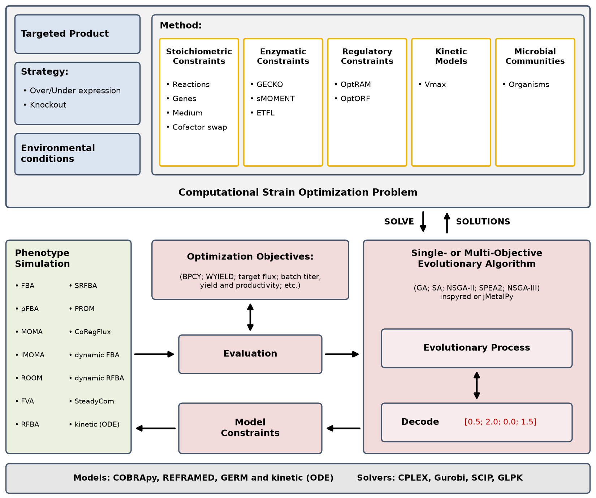

# Introduction

**Metabolic Engineering Workbench in Python**

MEWpy is a Computational Strain Optimization (CSO) tool able to aggregate different types of constraint-based models and simulation approaches. It relies on Evolutionary Algorithms (EAs) to identify the set of genetic modifications that favor and optimize a desired metabolic engineering goal. One of the main advantages of using EAs is that they enable the simultaneous optimization of more than one objective (product rate, growth rate, number of modifications, etc.), sometimes conflicting, and deliver in a single run a set of trade-off solutions between the objectives.

MEWpy supports [REFRAMED](https://github.com/cdanielmachado/reframed) and [COBRApy](https://opencobra.github.io/cobrapy/) models through a common simulator API, so the same code runs on models of either package. It provides:

- phenotype simulation: Flux Balance Analysis (FBA), parsimonious FBA (pFBA), Minimization of Metabolic Adjustment (MOMA) and its linear version (lMOMA), Regulatory On/Off Minimization (ROOM), Flux Variability Analysis (FVA), and essential reactions and genes;
- dynamic FBA of batch cultures, of a single organism (`DynamicFBA`) or of a community on a shared medium (`CommunityDynamicFBA`);
- enzyme-constrained (GECKO, sMOMENT, ETFL) and kinetic models;
- integrated metabolic and regulatory models (the GERM framework), with Regulatory FBA (RFBA), dynamic RFBA, Steady-state Regulatory FBA (SRFBA), Probabilistic Regulation of Metabolism (PROM) and CoRegFlux;
- integration of expression data with eFlux, GIMME and iMAT;
- microbial communities: SteadyCom and the SMETANA scores;
- strain design problems for each of these model types, solved with the [inspyred](https://github.com/aarongarrett/inspyred) or [jMetalPy](https://github.com/jMetal/jMetalPy) optimization engines.

MEWpy requires a linear programming solver: CPLEX, Gurobi, SCIP or GLPK (see [Installation](install.md)).

The source code is available at [github.com/vmspereira/MEWpy](https://github.com/vmspereira/MEWpy).
